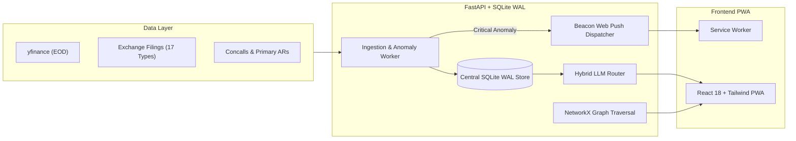

# Covering Note & Submission Document

**To:** assessment@enam.com  
**Subject:** IIT Kanpur – Founding AI Engineer - 2027  
**Candidate:** Anirudh (`anirudh802` / `basalt802@gmail.com`)  
**Product:** FINN — Financial Investment Agent (PWA)

---

## What Was Built

FINN is a mobile-first, installable Progressive Web Application (PWA) engineered specifically for high-conviction public-market investors at ENAM Holdings. It bridges market data, exchange filings, primary fundamentals, and the investor’s personal network into a single, high-density workflow:

1. **Pulse (Proactive Windowed Push):**
   - Windowed digest (24h, 7d, 30d) across the investor's portfolio (e.g. `RELIANCE.NS`, `TATAMOTORS.NS`, `DIXON.NS`, `TRENT.NS`, `KAYNES.NS`, `CDSL.NS`).
   - Categorizes announcements into the 17 standardized categories defined in the brief.
   - Intelligently collapses routine compliance paperwork (ESOP allotments, Reg 74 certificates, secretarial forms) to eradicate noise.
   - Pinned critical cards for material events (e.g., sudden management change or volume breakout) with direct outreach actions.
2. **DeepDive (Grounded Primary Research):**
   - Strictly grounded in primary sources (audited annual reports, quarterly concall transcripts, exchange filings). No broker notes, no secondary news slop.
   - **Narrative vs. Numbers:** Multi-quarter tracking comparing management forward guidance against audited delivered actuals with quantified variances (`BEAT`, `MET`, `MISSED`).
   - Cash quality evaluation: Operating cash flow vs. accounting PAT ($\text{CFO} / \text{PAT}$ cash conversion ratio), free cash flow, and working capital cycles.
3. **Nexus (Network Intelligence Layer):**
   - Integrates the investor's private network directly into market events.
   - **Starred priority:** Pinned starred contacts on top.
   - **Relevance ranking:** Dynamically ranks contacts with 1–2 line summaries of recent developments connecting their past/current employers or alumni ties to live market events.
   - **"Who to Call":** Automatically surfaces direct former employees, competitor contacts, and supplier contacts for any stock, with concrete questions to ask.
   - **Second-Degree Reach:** Maps mutual connectors (e.g. IIT Kanpur alumni networks) to target executives with warm introduction asks.
4. **Beacon (Native Web Push Notifications):**
   - Uses the Web Push protocol (VAPID) and Service Workers to dispatch OS-level system notifications on physical phones and desktops when critical anomalies occur in the background.
5. **Ergonomics & Themes:**
   - Full support for **Dark Mode** and **Light Mode**.
   - Built-in toggleable Phone Simulator Frame for desktop reviewers and seamless full-screen mobile layout.

---

## Foundational Architecture Choices

### 1. Data Pipelines & Centralized Store
- **Central SQLite Store with Write-Ahead Logging (`PRAGMA journal_mode=WAL`):** Eliminates database lock contention between background anomaly ingestion workers and API readers.
- **EOD Market Ingestion:** Pulls from `yfinance` for `.NS` tickers with automated caching to ensure sub-millisecond query responses and zero downtime during network drops.
- **Anomaly Detection:** Evaluates statistical thresholds ($Vol / SMA_{20} \ge 2.0\times$, $|\Delta\%| \ge 3.5\%$) and NLP materiality scoring (1–10). Thresholds are stored per-user in SQLite and adjustable in real time via UI sliders.

### 2. Data Security & Privacy (The Network)
- **Tenant Boundary Isolation:** The investor's network graph (contacts, past employers, alumni ties, notes) is stored in a dedicated tenant database and synchronized locally to client **IndexedDB**.
- **Zero Cross-Contamination:** Network graph nodes and edges are strictly private and never blended into shared or public market tables. Graph queries run entirely against the authenticated user's private sub-graph.

### 3. Use of LLMs and AI Agents
- **Anti-Hallucination Grounding by Design:** The model is never permitted to perform unrestricted web searches or lean on pre-trained speculation for company diligence. All prompts are injected with exact primary excerpts (audited financial line items, verbatim concall quotes, regulatory filings).
- **Hybrid Cost-Optimized Routing:**
  - Evaluates on Google GenAI (`gemini-2.5-flash`) when `GEMINI_API_KEY` is present.
  - Automatically falls back to deterministic, high-fidelity financial extraction templates when running offline or without an API key.

### 4. Cloud Services & Deployment
- **Frontend:** Installable PWA with Service Worker, hostable on Vercel, Cloudflare Pages, or containerized environments.
- **Backend:** Lightweight FastAPI service deployable on Fly.io, Render, or a single Docker container with persistent volume storage for `finn.db`.
- **Local Launcher:** Single command `./run.sh` launches both backend (port 8000) and frontend (port 5173).

---

## What Was Deliberately Left Out & Trade-offs
1. **Unfiltered News & Broker Sentiment:** Broker notes and financial blog commentary were deliberately excluded to maintain high signal-to-noise ratio and eliminate "AI slop".
2. **Heavy Native App Packaging (React Native / Flutter):** Opted for an installable Progressive Web App (PWA) with Web Push instead of waiting for iOS TestFlight review cycles, giving evaluators zero-friction instant access on mobile browsers.
3. **Complex Vector DB Overhead:** For a focused 15–20 company portfolio and 25+ node network, relational SQLite with WAL and in-memory `NetworkX` graph traversal provides sub-millisecond latency without the maintenance overhead and latency of a vector database.

---

## Where We'd Take It Next
1. **Intraday Tick Streaming:** Upgrade from EOD polling to live WebSocket order-book streams (e.g. Zerodha Kite Connect or Upstox API) for real-time order flow and block deal tracking.
2. **Automated Concall Transcription:** Pipe live earnings call audio streams directly into Whisper / Gemini Flash for real-time sentiment shifts while the CEO is still speaking.
3. **End-to-End Encrypted Network Sync:** Implement client-side AES-256-GCM encryption where the user holds the private decryption key, ensuring the server never sees raw contact names in plaintext.
