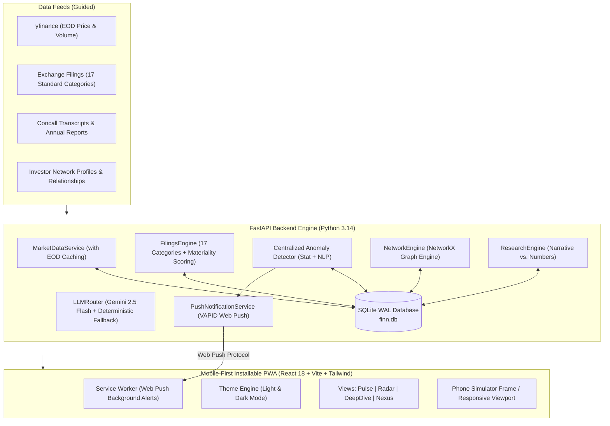

# FINN — Build Documentation & Progress Report

**Project:** FINN (Financial Intelligence & Network Navigator)  
**Author:** Anirudh (`anirudh802` / `basalt802@gmail.com`)  
**Target:** ENAM Holdings — Founding AI Engineer Build Challenge  
**Date:** November 2026  
**Repository Branch:** `main`

---

## Executive Summary & System Overview

FINN is a mobile-first, installable Progressive Web Application (PWA) built for high-conviction public-market investors at ENAM Holdings. It resolves three core investor challenges:
1. **Filtering Information Overload:** Surfaces high-materiality corporate announcements across a 15–20 stock portfolio, collapsing routine compliance filings and flagging price/volume anomalies.
2. **Primary-Source Grounded Diligence:** Provides on-demand company analysis strictly derived from primary disclosures (annual reports, quarterly concall transcripts, exchange filings) featuring a **"Narrative vs. Numbers"** track record (promised guidance vs. actual delivered results).
3. **Activating the Latent Investor Network:** Connects market events directly to the investor's personal network, identifying who to call, 2nd-degree executive introductions (e.g. via IIT Kanpur alumni ties), and warm reconnect prompts when a contact's past employer has major news.

---

## 1. System Architecture



---

## 2. Completed Phases & Deliverables

### Phase 1: Environment, Git Setup, Architecture Records & Governance
- **Git Version Control:**
  - Initialized repository on `main` branch.
  - Configured author identity: `anirudh802` (`basalt802@gmail.com`).
  - Strict `.gitignore` protecting secrets (`.env`), Python caches (`__pycache__`), virtual environments (`venv/`), and database files (`*.db`, `*.db-wal`).
- **Architecture Decision Records (`docs/adr/`):**
  - [ADR-001: Installable Progressive Web Application (PWA) with Web Push](file:///home/runcandel/enam/docs/adr/ADR-001-pwa-mobile-first.md) — Rationale for cross-platform PWA with native OS notifications over store review friction.
  - [ADR-002: Centralized SQLite (WAL Mode) Anomaly Pipeline & Store](file:///home/runcandel/enam/docs/adr/ADR-002-centralized-anomaly-store.md) — Rationale for background anomaly evaluation, WAL mode concurrency, and persistent threshold storage.
  - [ADR-003: Tenant-Isolated & Client-Cached Network Graph](file:///home/runcandel/enam/docs/adr/ADR-003-tenant-privacy-graph.md) — Privacy-first separation of the investor's private contact network from public market feeds.
- **Agent Governance Files (`AGENTS.md`):**
  - [Root AGENTS.md](file:///home/runcandel/enam/AGENTS.md): Overall mission, discrete setup/run commands, and global guardrails (no secondary slop, strict primary sources, privacy first).
  - [Backend AGENTS.md](file:///home/runcandel/enam/backend/AGENTS.md): Directory layout, FastAPI endpoints, WAL SQLite rules, and testing commands.
  - [Frontend AGENTS.md](file:///home/runcandel/enam/frontend/AGENTS.md): PWA service worker rules, touch ergonomics (44x44px), dark/light palettes, and state conventions.
  - [Data AGENTS.md](file:///home/runcandel/enam/data/AGENTS.md): Indian ticker rules (`.NS` suffix), financial units (₹ Cr, bps), and seed data contracts.
- **High-Fidelity Indian Equity Seed Dataset (`backend/app/data/seed_data.py`):**
  - **22 Companies (18 Mock Portfolio + 4 Ad-hoc Research):**
    - High-conviction portfolio: `RELIANCE.NS`, `TATAMOTORS.NS`, `DIXON.NS`, `TRENT.NS`, `KAYNES.NS`, `CDSL.NS`, `HDFCBANK.NS`, `DEEPAKNTR.NS`, `POLYCAB.NS`, `PERSISTENT.NS`, `SUNPHARMA.NS`, `LT.NS`, `TITAN.NS`, `KPITTECH.NS`, `ASTRAL.NS`, `PIIND.NS`, `SYNGENE.NS`, `CLEAN.NS`.
    - Ad-hoc research set: `ZOMATO.NS`, `DIVISLAB.NS`, `HAL.NS`, `DMART.NS`.
  - **12 Exchange Filings across the 17 Standard Categories:**
    - High-materiality results (Dixon Tech +120% YoY mobile revenue, Trent +39% retail revenue, Tata Motors Q2 margin drop).
    - Executive management changes (Kaynes Tech hiring Dixon VP as COO; Deepak Nitrite CFO transition).
    - M&A (Reliance-Disney ₹70,352 Cr joint venture).
    - Capex (Kaynes ₹3,300 Cr Sanand semiconductor OSAT plant).
    - Routine paperwork tagged for automatic collapsing (HDFC Bank ESOPs, Reliance Reg 74(5), LT duplicate shares).
  - **Guidance Track Record ("Narrative vs. Numbers"):**
    - Multi-quarter tables recording promised forward guidance quotes vs. audited delivery (Dixon mobile volume beat, Dixon margin dilution miss, Trent Zudio 200 store expansion, Tata Motors JLR aluminum flood impact).
  - **Investor Network Graph (10 Core Nodes + Cross-links):**
    - IIT Kanpur alumni (Ananya Roy, Rohan Deshmukh, Siddharth Verma, Vikram Seth).
    - Supply chain leaders (Xiaomi India sourcing director, ex-Trent Zudio head of merchandising, BSR & Co lead audit partner).
    - Explicit 1st and 2nd degree relationships.

---

### Phase 2: Core Backend Engines, Data Pipelines & APIs
- **Database Architecture (`backend/app/db/database.py`):**
  - Central SQLite store with Write-Ahead Logging (`PRAGMA journal_mode=WAL`).
  - Tables: `companies`, `market_eod`, `announcements`, `concall_transcripts`, `guidance_history`, `detected_anomalies`, `user_preferences`, `push_subscriptions`, `network_contacts`, `network_relationships`.
  - Indexes on tickers, timestamps, and anomaly severity for sub-millisecond query performance.
- **Market Data Pipeline (`backend/app/services/market_data.py`):**
  - Integrates `yfinance` for `.NS` tickers with automated fallback to cached SQLite records.
  - Computes 20-day SMA of volume, daily return percentage, and volume surge multiples.
- **Filing Categorization & Materiality Engine (`backend/app/services/filings_engine.py`):**
  - Classifies announcements into the 17 categories specified in the challenge brief.
  - Scores materiality from 1 to 10 based on corporate action impact.
  - Filters and groups low-relevance filings (`unclassified`, ESOPs, routine paperwork) into an expandable collapsed group.
- **Centralized Anomaly Detector (`backend/app/services/anomaly_detector.py`):**
  - Compares live market data against user-defined thresholds (default: volume multiple $\ge 2.0\times$, price move $\ge \pm 3.5\%$).
  - Evaluates material filings and management changes.
  - Automatically flags `CRITICAL` anomalies and pins them to the top of the feed.
  - Dispatches Web Push notifications when critical anomalies are detected.
  - Supports user-configurable threshold updates via REST API.
- **Web Push Notification Service — Beacon (`backend/app/services/push_notifications.py`):**
  - Implements the Web Push protocol with VAPID key pairs (`pywebpush`).
  - Manages browser subscriptions and broadcasts native system notifications.
  - Maintains an in-memory notification log for instant in-app delivery.
- **Network Intelligence Engine — Nexus (`backend/app/services/network_engine.py`):**
  - Built with `NetworkX` graph traversal.
  - Implements **Starred Contacts Priority** (starred contacts pinned at the top).
  - Implements **Relevance-Ranked Feed** with dynamic 1–2 line recent development summaries.
  - Implements **"Who Should I Call?"** identifying direct, competitor, and supplier contacts for any stock with specific questions to ask.
  - Implements **Second-Degree Reach** finding mutual connector paths (e.g. IIT Kanpur alumni networks) to target executives.
- **Primary-Source Research Engine — DeepDive (`backend/app/services/research_engine.py` & `llm_router.py`):**
  - Strictly grounded in primary documents (audited financials, concall transcripts, exchange filings).
  - Anti-hallucination policy forbidding external web conjecture or secondary news slop.
  - Hybrid LLM router: leverages Google GenAI (`gemini-2.5-flash`) when `GEMINI_API_KEY` is provided, with deterministic expert-grade fallback templates when absent.
- **FastAPI Endpoints (`backend/app/api/endpoints.py`):**
  - Health check: `GET /api/health`
  - Portfolio & companies: `GET /api/companies`
  - Windowed digest: `GET /api/push/digest` (with 24h, 7d, 30d windows)
  - Pinned alert: `GET /api/push/pinned-alert`
  - Ranked alerts: `GET /api/push/alerts`, `POST /api/push/alerts/{id}/pin`, `POST /api/push/alerts/{id}/dismiss`
  - Threshold preferences: `GET /api/preferences`, `PUT /api/preferences`
  - Web Push: `GET /api/notifications/vapid-key`, `POST /api/notifications/subscribe`, `POST /api/notifications/test`
  - Primary research: `GET /api/pull/research/{ticker}`
  - Network feed & actions: `GET /api/network/feed`, `POST /api/network/contacts/{id}/star`, `GET /api/network/who-to-call/{ticker}`, `GET /api/network/second-degree`
  - On-demand pipeline trigger: `POST /api/pipeline/run`

---

## 3. Automated Test Suite & Verification Results

All 14 automated unit and integration tests run cleanly with zero failures and zero warnings:

```bash
cd backend && ./venv/bin/pytest -v
```

```
============================= test session starts ==============================
platform linux -- Python 3.14.9, pytest-9.2.0, pluggy-1.7.0 -- backend/venv/bin/python3
rootdir: /home/runcandel/enam/backend
configfile: pytest.ini
testpaths: tests
plugins: platformdirs-4.14.5, anyio-4.16.0
collected 14 items

tests/test_api.py::test_health_endpoint PASSED                           [  7%]
tests/test_api.py::test_companies_endpoint PASSED                        [ 14%]
tests/test_api.py::test_digest_endpoint PASSED                           [ 21%]
tests/test_api.py::test_pinned_alert_endpoint PASSED                     [ 28%]
tests/test_api.py::test_preferences_endpoint PASSED                      [ 35%]
tests/test_api.py::test_research_endpoint PASSED                         [ 42%]
tests/test_api.py::test_network_feed_and_starring PASSED                 [ 50%]
tests/test_services.py::test_filing_classification PASSED                [ 57%]
tests/test_services.py::test_windowed_digest PASSED                      [ 64%]
tests/test_services.py::test_anomaly_ranking_and_top_pinned PASSED       [ 71%]
tests/test_services.py::test_network_feed_starred_priority PASSED        [ 78%]
tests/test_services.py::test_who_to_call PASSED                          [ 85%]
tests/test_services.py::test_second_degree_reach PASSED                  [ 92%]
tests/test_services.py::test_pull_research_narrative_vs_numbers PASSED   [100%]

============================== 14 passed in 0.98s ==============================
```

---

## 4. Phase 3 Frontend Blueprint & Specifications

The frontend will be built as an installable Progressive Web Application:
- **Framework:** React 18 + Vite + TypeScript + Tailwind CSS + Lucide Icons.
- **PWA Capabilities:** Web App Manifest (`manifest.json`), Service Worker (`sw.js`) with Web Push notification listener, and mobile "Add to Home Screen" support.
- **Dual Theme Engine:** Full support for **Dark Mode** (sleek financial slate/navy) and **Light Mode** (clean high-contrast paper) with user toggle persisted in `localStorage`.
- **Desktop Simulator:** Built-in phone frame container for desktop reviewers with a toggle to switch to edge-to-edge full screen.
- **View Architecture:**
  1. **Pulse (Default Landing View):**
     - Pinned dismissible critical alert card on top.
     - Windowed digest segmented bar (`24h` / `7d` / `30d`).
     - Category filter chips (`All`, `Results`, `M&A`, `Mgmt Change`, `Capex`).
     - Prioritized material cards with QoQ/YoY tags.
     - Collapsed routine paperwork accordion.
  2. **Radar (Anomaly Alerts & Thresholds):**
     - Ranked severity stream (`CRITICAL` > `HIGH` > `MEDIUM`) with pinned alerts locked at top.
     - Interactive sliders for Volume Surge Multiplier ($1.5\times$ to $5.0\times$) and Price Move ($\pm 2\%$ to $\pm 10\%$).
  3. **DeepDive (Primary Research):**
     - Universal NSE ticker search bar with quick pills for portfolio stocks.
     - "Narrative vs. Numbers" table with `BEAT`, `MET`, `MISSED` badges.
     - Financial health chips, cash conversion ratio ($\text{CFO} / \text{PAT}$), and bull/bear synthesis.
  4. **Nexus (Network Intelligence):**
     - Starred contacts pinned at the top with gold stars.
     - Relevance-ranked contacts with concise 1–2 line development summaries.
     - "Who Should I Call?" company outreach drawer.
     - 2nd-degree connection visualizer.
