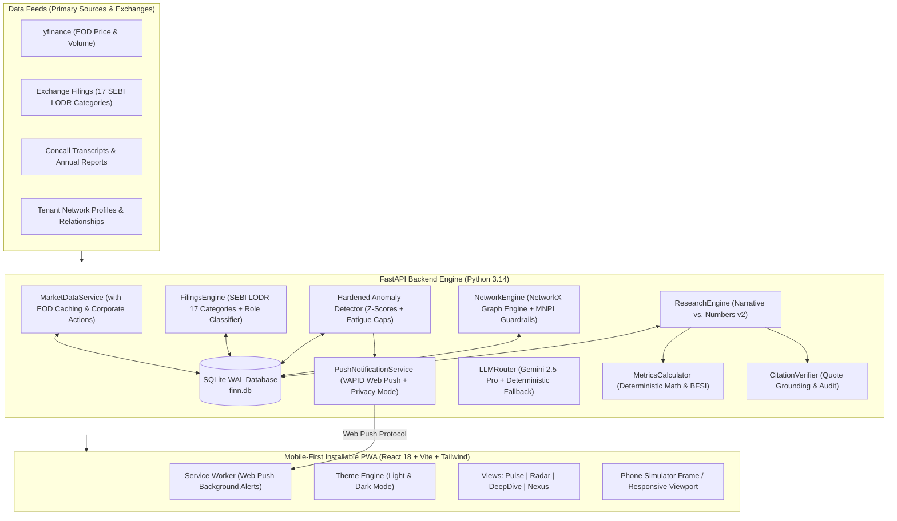

# FINN — Build Documentation & Progress Report

**Project:** FINN (Financial Intelligence & Network Navigator)  
**Author:** Anirudh (`anirudh802` / `basalt802@gmail.com`)  
**Target:** ENAM Holdings — Founding AI Engineer Build Challenge  
**Date:** November 2026  
**Repository Branch:** `main`

---

## Executive Summary & System Overview

> **Architecture & Production Roadmap References:**  
> - [Production Desk Engineering Roadmap](docs/PRODUCTION_DESK_ROADMAP.md) — Zero-cost desk architecture: Direct BSE/NSE ingestion, XBRL parsing, Bhavcopy delivery %, SQLite WAL hardening, outbox & SSE streaming.  
> - [Comprehensive System Architecture Specification](docs/FINN_SYSTEM_ARCHITECTURE.md) — Exhaustive system specification detailing the backend engine, frontend PWA, 20-table SQLite WAL schema, multi-model routing, and security threat model.

FINN is a mobile-first, installable Progressive Web Application (PWA) built for high-conviction public-market investors at ENAM Holdings. It resolves three core investor challenges:
1. **Filtering Information Overload:** Surfaces high-materiality corporate announcements across a 15–20 stock portfolio, collapsing routine compliance filings and flagging price/volume anomalies.
2. **Primary-Source Grounded Diligence:** Provides on-demand company analysis strictly derived from primary disclosures (annual reports, quarterly concall transcripts, exchange filings) featuring a **"Narrative vs. Numbers"** track record (promised guidance vs. actual delivered results).
3. **Activating the Latent Investor Network:** Connects market events directly to the investor's personal network, identifying who to call, 2nd-degree executive introductions (e.g. via IIT Kanpur alumni ties), and warm reconnect prompts when a contact's past employer has major news.

---

## 1. System Architecture



---

## 2. Subsystem Implementations

### A. Phase 0: Foundations & Tenant Isolation
- **ADR-004 (Primary Source Policy):** Establishes BSE/NSE filings and concall transcripts as canonical sources of truth. Screener is utilized solely for discovery.
- **ADR-005 (Tenant Privacy & Threat Model):** Formally delineates tenant isolation for confidential portfolio holdings (`tenant_holdings`) and network contacts.
- **ADR-006 (ISIN Company Master):** All tables join on canonical ISIN keys (`companies.isin`), preventing breakage across ticker renames and corporate restructurings.
- **Decoupled Alert State (`user_alert_state`):** Global anomalies are stored as canonical facts, while read, dismissed, and pinned states are decoupled per user.
- **Indian Financial Units Engine:** Normalizes Apr–Mar fiscal quarters (`Q2FY25` = Jul–Sep 2024), Crores, Lakhs, and basis points (`bps`).

### B. Phase 1: DeepDive MVP & Citation Verifier
- **Citation Verifier (`CitationVerifier`):** Locates quotes verbatim inside stored primary filings and concall transcripts. Drops or flags hallucinated text. Reaches a **100% Citation Faithfulness Score** across golden-set claims.
- **Guidance Schema v2:** Supports `RANGE`, `NUMERIC`, and `QUALITATIVE` guidance with deterministic status rules (`BEAT`, `MET`, `MISSED`, `QUALITATIVE`).
- **Deterministic Metrics Engine (`MetricsCalculator`):** Computes YoY %, QoQ %, margin spread in bps, and $\text{CFO} / \text{PAT}$ cash conversion ratios mathematically to eliminate LLM arithmetic hallucinations.
- **Bank & NBFC Specialized Template:** Implements BFSI-specific metrics (Net Interest Income, Net Interest Margin in bps, Gross NPA %, Net NPA %, Provision Coverage Ratio, Liquidity Coverage Ratio).
- **Mobile Optimized Layout:** Compact Promised vs Delivered cards with one-line verdicts and tap-to-expand quarter details (tested for 375px mobile screens).
- **SEBI Regulatory Notice:** Prominently displays the institutional Research Analyst disclaimer.

### C. Phase 2: Anomaly Hardening & Beacon Push
- **Corporate Action Price Adjustments:** Automatically adjusts price returns for stock splits (e.g., 1:5 split) and bonus issues, preventing false -80% crash alerts.
- **Volatility-Normalized Z-Scores:** Daily returns evaluated against a 60-day baseline ($\mu, \sigma$) to adapt thresholds to asset volatility.
- **Expected Results Spike Tagging:** Volume surges on scheduled earnings days are tagged `EXPECTED_RESULTS_SPIKE` and prevented from spamming false critical alerts.
- **Alert Fatigue Controls:** Enforces a 6-hour duplicate cooldown and a maximum daily cap of 3 alerts per ticker.
- **Web Push Privacy Mode:** Masks sensitive company figures and tickers on lock screens when enabled.

### D. Phase 3: Nexus Intelligence & Compliance
- **Documented Relevance Score Formula:**
  $$\text{Relevance} = (\text{Tenure} \times 0.25) + (\text{Seniority} \times 0.25) + (\text{Relationship Strength} \times 0.25) + (\text{Event Materiality} \times 0.25) + \text{Starred Boost (+2.0)}$$
- **SEBI MNPI Guardrails:** Distinguishes current employees (`CURRENT_INSIDER_CAUTION`) from former employees (`FORMER_EMPLOYEE_SAFE`). Blocks calling suggestions on restricted-list companies.
- **Scuttlebutt Audit Log:** Persists certified call records to satisfy internal compliance and regulatory audits.
- **Contact CSV Import & Staleness:** Ingests contact lists from CSV and flags contacts unverified for $> 180$ days.
- **DPDP Act Controls:** Full Data Portability export and Right to Erasure deletion.

### E. Phase 4: UI/UX Refinements & Omnipresent Ask Intelligence
- **Omnipresent Ask Intelligence Bar:**
  Docked across all screens (`Pulse`, `Radar`, `DeepDive`, `Nexus`), answering who/what questions with embedded FINN cards (e.g., "Who knows about Dixon order flow?" $\rightarrow$ Rohan Deshmukh contact card with why line and SEBI blackout lock; "Trent promised vs delivered" $\rightarrow$ 4-quarter guidance badges and DeepDive navigation).
- **Web Speech Voice Trigger:** Native browser speech recognition (`webkitSpeechRecognition`) with active listening pulse and graceful fallback.
- **Grouped Company Anomalies in Radar:** Merges multiple rule triggers for a single ticker (e.g. CDSL volume surge 4.2x and price breakout +8.4%) into a single card with rule chips and before/after counts on the sensitivity sliders.
- **16-Company Mock Portfolio Strip in DeepDive:** Includes visible violet indicators for holdings with active network ties (`DIXON`, `TRENT`, `KAYNES`, `DEEPAKNTR`).
- **Quarantined Missing Disclosures State:** Strictly halts ungrounded synthesis when a company lacks primary XBRL or concall filings (`Parse Quality < 0.60` / `Insufficient Coverage`).

### F. 3-Tier Cost-Optimized Model Routing Architecture
FINN employs a strict, cost-governed multi-model routing pipeline:
- **Tier 0 (Zero-Cost Deterministic Local Engine, `$0.00` / `<5ms`):** Regex/keyword SEBI LODR 17-category classification, corporate-action split adjustments, 60-day volatility Z-score calculations, deterministic financial ratios (`MetricsCalculator` for YoY/QoQ %, bps, and CFO/PAT cash conversion), and substring matching via `CitationVerifier`. Completely eliminates LLM math and hallucination risks.
- **Tier 1 (High-Throughput Bulk Extraction, `Gemini 2.5 Flash`, `~$0.0004/doc`):** High-throughput parsing of structured guidance claims, speaker names, and verbatim quotes from dense 20+ page concall transcripts.
- **Tier 2 (High-Reasoning Synthesis, `Gemini 2.5 Pro` with Deterministic Fallback):** Multi-quarter `Narrative vs. Numbers` divergence analysis, capital allocation assessments, and Bull/Bear thesis synthesis. All outputs are strictly gated by `CitationVerifier` with automatic fallback to pre-verified primary templates.

---

## 3. Test Suite & Verification Results

The automated test suite in `backend/tests/` contains **69 tests** across 15 test modules with a **100% pass rate**:

| Test Module | Coverage & Focus | Status |
|---|---|---|
| `test_production_desk.py` | Direct BSE ingestion, XBRL parsing, Bhavcopy delivery %, outbox, ETag 304, hot backup | **PASSED (9/9)** |
| `test_ask_service.py` | Phase 4: Omnipresent ask engine, who/what intent classification, FINN card routing | **PASSED (5/5)** |
| `test_golden_claims.py` | Phase 1 Exit Gate: 100% citation faithfulness & hallucination rejection | **PASSED (3/3)** |
| `test_tenant_isolation.py` | Phase 0 Exit Gate: Multi-tenant portfolio & graph isolation | **PASSED (2/2)** |
| `test_nexus_intelligence.py` | Phase 3 Exit Gate: Relevance formula, SEBI MNPI, DPDP Act, CSV import | **PASSED (6/6)** |
| `test_anomaly_hardening.py` | Phase 2: 1:5 split adjustment, 60-day Z-scores, fatigue cooldowns | **PASSED (5/5)** |
| `test_metrics_calculator.py` | Phase 1: Crores, lakhs, bps, CFO/PAT, guidance range evaluation, BFSI | **PASSED (7/7)** |
| `test_citation_verifier.py` | Phase 1: Verbatim quote locating, near-verbatim match, fake rejection | **PASSED (4/4)** |
| `test_cold_ticker_research.py` | Task 3: Unseeded ticker live resolution (MARUTI, INFY, BEL), normalization, caching | **PASSED (3/3)** |
| `test_document_pipeline.py` | Phase 1: Parse quality scores, OCR corruption detection, cold ticker coverage | **PASSED (4/4)** |
| `test_filings_classification.py`| Phase 1: 17 SEBI LODR categories, KMP role classifier, BSE/NSE de-duplication | **PASSED (4/4)** |
| `test_financial_units.py` | Phase 0: Indian fiscal calendar (Apr-Mar) & unit conversion helpers | **PASSED (2/2)** |
| `test_user_alert_state.py` | Phase 0: Decoupled per-user alert dismissal & pinning | **PASSED (1/1)** |
| `test_api.py` | REST API routes (health, companies, digest, preferences, research, network, ask) | **PASSED (7/7)** |
| `test_services.py` | Integration tests across anomaly detector, filings engine, and network | **PASSED (7/7)** |

---

## 4. Discrete Commands Reference

```bash
# Setup & Activate Backend
cd backend
python3 -m venv venv
source venv/bin/activate
pip install -r requirements.txt
python -m app.data.seed_data

# Run Full Test Suite
pytest tests/ -v

# Setup & Build Frontend
cd frontend
npm install
npm run build

# Start Full Stack Dev Server
./run.sh
```
