# FINN — Financial Investment Agent

[](https://finn-frontend-lac.vercel.app)
[](https://github.com/anirudh802/ENAM-task)
[](https://finn-frontend-lac.vercel.app)
[](https://github.com/anirudh802/ENAM-task)
[](https://github.com/anirudh802/ENAM-task)

> **Live Deployed App (Mobile-First PWA):** [https://finn-frontend-lac.vercel.app](https://finn-frontend-lac.vercel.app)  
> **Candidate:** Anirudh (`anirudh802` / `basalt802@gmail.com`) — IIT Kanpur  
> **Challenge:** ENAM Holdings — Founding AI Engineer Build Challenge (2027)

---

## Executive Overview

FINN is an institutional-grade, mobile-first Progressive Web Application (PWA) built specifically for high-conviction public-market investors at ENAM Holdings. It eliminates information overload through deterministic filing classification, primary-source citation verification, and privacy-preserving personal network intelligence.

```mermaid
flowchart LR
    subgraph Data ["Data Inputs"]
        YF["Live EOD Prices (yfinance)"]
        Filings["Exchange Filings (17 SEBI LODR)"]
        Transcripts["Concall Transcripts & ARs"]
        Graph["Private Network Graph"]
    end

    subgraph FINN ["FINN Core Engine"]
        Pulse["1. Pulse\n(Windowed Push & Splits)"]
        Radar["2. Radar\n(Vol-Z Anomaly Engine)"]
        DeepDive["3. DeepDive\n(Promised vs Delivered v2)"]
        Nexus["4. Nexus\n(Network Intelligence & SEBI PIT)"]
        Ask["Omnipresent Ask Layer\n(Deterministic + LLM Routing)"]
    end

    subgraph Client ["Client Surfaces"]
        PWA["Mobile PWA (375px+)\nDark & Light Modes"]
        Push["Native Web Push Alerts"]
    end

    Data --> FINN
    FINN --> Client
```



---

## 4 Core Capabilities

### 1. Pulse (Windowed Proactive Push)
- **Deterministic LODR Classification:** Maps corporate disclosures into all 17 standard SEBI LODR Schedule III categories with materiality scoring (1 to 10).
- **Cross-Exchange Deduplication:** Deduplicates identical BSE and NSE corporate announcements within 3-hour windows.
- **Corporate Action Split Adjustment:** Automatically adjusts prices for stock splits (e.g. 1:5) and bonus issues to prevent false -80% crash alerts.
- **Noise Elimination:** Collapses routine compliance filings (ESOP allotments, Reg 74 certificates, secretarial disclosures).

### 2. Radar (Technical & Volume Anomaly Detector)
- **Volatility-Normalized Z-Scores:** Returns and volumes evaluated against a 60-day historical baseline ($\mu, \sigma$).
- **Alert Fatigue Controls:** Enforces a 6-hour duplicate alert cooldown and a strict daily cap (max 3 alerts per ticker per day).
- **Consolidated Anomaly Cards:** Multi-signal breakouts (e.g., volume surge 4.2x + price breakout +8.4%) grouped into single unified actionable cards.

### 3. DeepDive (Grounded Primary Research)
- **Strict Primary Grounding:** Relies exclusively on official concall transcripts, annual reports, and exchange filings. Zero broker notes or web scrapers.
- **Guidance Schema v2 ("Promised vs. Delivered"):** Tracks multi-quarter management forward guidance against actual audited results (`RANGE`, `NUMERIC`, `QUALITATIVE` evaluated as `BEAT`, `MET`, `MISSED`).
- **Citation Verification Gate:** Every claim and quote is validated against primary text using `CitationVerifier`. Hallucinated quotes fail verification and are rejected.
- **Cold-Ticker Coverage Metric:** Reports document coverage percentage before diligence execution (e.g., `25% Coverage • 0 of 4 transcripts, annual report found` on cold tickers like `MARUTI.NS`).
- **BFSI Financial Template:** Net Interest Margin (NIM in bps), Gross/Net NPA %, Provision Coverage Ratio (PCR), and Liquidity Coverage Ratio (LCR).

### 4. Nexus (Network Intelligence Layer)
- **Contextual Network Surfacing:** Connects market events directly to the investor's personal network with tenant isolation.
- **SEBI PIT Guardrails:** Distinguishes current insiders (`CURRENT_INSIDER` caution) from former employees (`FORMER_EMPLOYEE_SAFE`). Firm-wide restricted list embargoes (e.g., Dixon active mandate embargo until 18 Nov 2026) block call actions.
- **Second-Degree Reach:** Surfaces warm introduction paths through mutual bridges (e.g. IIT Kanpur alumni networks).
- **Mathematical Relevance Score:**
  $$\text{Relevance} = (\text{Tenure} \times 0.25) + (\text{Seniority} \times 0.25) + (\text{Strength} \times 0.25) + (\text{Materiality} \times 0.25) + \text{Starred Boost (+2.0)}$$

---

## "Live vs. Seeded" Data Disclosure

| Domain | Source | Realism & Implementation |
| :--- | :--- | :--- |
| **Market Prices & Volumes** | **Live** (`yfinance`) | Real live End-of-Day pricing, 60-day moving averages, and volume multiples. |
| **Exchange Announcements** | **Seeded & Primary** | Primary SEBI disclosures for portfolio universe (Dixon, Trent, Tata Motors, Kaynes, etc.) clearly labeled as *Seeded demo filing* where synthetic. |
| **Transcripts & Guidance** | **Primary Sources** | Audited quarterly earnings transcripts and FY26 MD&A annual reports. |
| **Investor Network Graph** | **Synthetic Mock Data** | Anonymized mock profiles engineered around DPDP and SEBI PIT principles with tenant isolation. |

---

## Architectural Decision Records (ADRs) & Documentation

All technical designs, trade-offs, and architecture specifications are documented in `docs/`:

- [Comprehensive System Architecture Specification](docs/FINN_SYSTEM_ARCHITECTURE.md)
- [Production Desk Roadmap](docs/PRODUCTION_DESK_ROADMAP.md)
- [Deployment Specification & Budget](docs/DEPLOYMENT_SPEC.md)
- [ADR-001: PWA Mobile-First Architecture](docs/adr/ADR-001-pwa-mobile-first.md)
- [ADR-002: Centralized SQLite Store with WAL Mode](docs/adr/ADR-002-centralized-anomaly-store.md)
- [ADR-003: Tenant Privacy & Personal Network Graph Engine](docs/adr/ADR-003-tenant-privacy-graph.md)
- [ADR-004: Primary Source-of-Truth Policy](docs/adr/ADR-004-source-of-truth-policy.md)
- [ADR-005: Tenant Privacy & Encryption Architecture](docs/adr/ADR-005-tenant-privacy-encryption.md)
- [ADR-006: ISIN-Keyed Company Master](docs/adr/ADR-006-isin-company-master.md)
- [AI Build History & Session Log](docs/AI_BUILD_HISTORY.md)

---

## Quickstart & Local Execution

### Discrete Commands

```bash
# 1. Clone repository
git clone https://github.com/anirudh802/ENAM-task.git
cd ENAM-task

# 2. Backend Setup & Run
cd backend
python3 -m venv venv
source venv/bin/activate
pip install -r requirements.txt
python -m app.data.seed_data       # Seeds SQLite WAL database
uvicorn app.main:app --port 8000 --reload

# 3. Frontend Setup & Run (in a new terminal)
cd frontend
npm install
npm run dev                         # Starts Vite dev server on :5173
```

### Fullstack Verification

```bash
# Backend Test Suite (All 72 tests)
cd backend && pytest tests/ -v

# Production Frontend Build
cd frontend && npm run build

# Health Check Endpoint
curl http://localhost:8000/api/health
```

---

## Cloud Deployment

- **Frontend:** Hosted on [Vercel](https://vercel.com) ([frontend/vercel.json](frontend/vercel.json) handles SPA routing rewrites and PWA manifest headers).
- **Backend:** Ready for deployment on [Render](https://render.com) using the included [render.yaml](render.yaml) blueprint.
